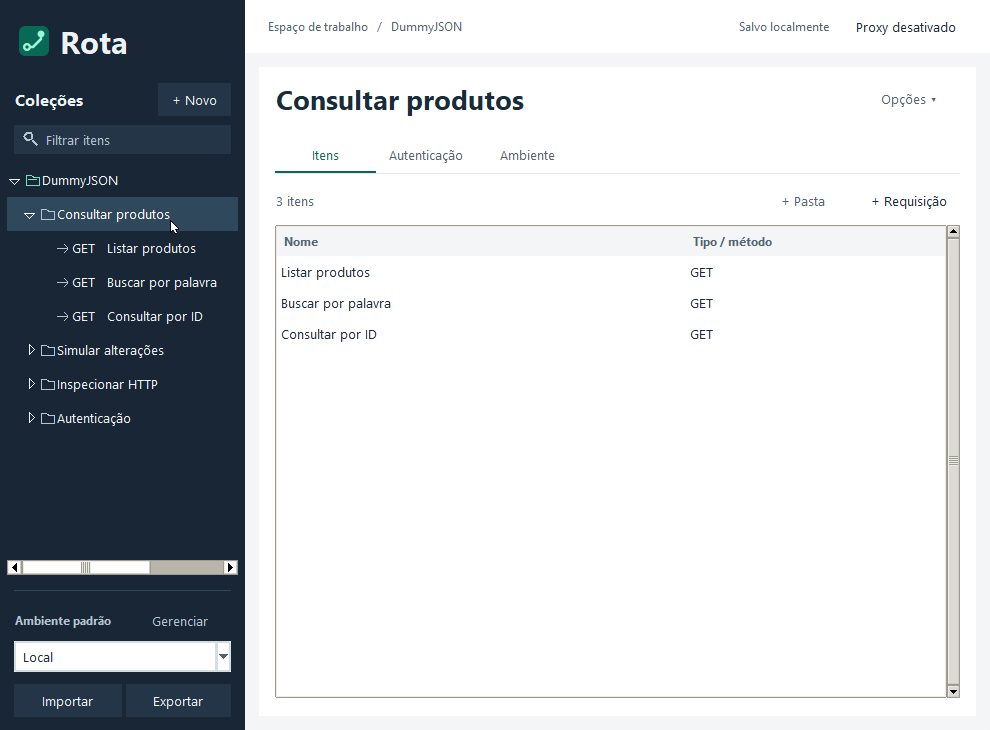

# Rota

*Suas APIs em teste.*

Cliente HTTP para desenvolvedores, feito em Python e Tkinter para Windows 11.



## Executar

Com Python 3.10 ou superior e Tkinter, execute na raiz do repositório:

```powershell
py outputs/rota.py
```

O aplicativo também funciona com apenas o arquivo [rota.py](outputs/rota.py). Ele usa a biblioteca padrão do Python.

## Testar com DummyJSON

Importe a coleção de exemplo e envie **Listar produtos** para ver sua primeira resposta. As 15 requisições cobrem produtos, cabeçalhos, login, perfil autenticado, renovação de sessão e respostas de erro. [Abrir exemplo e instruções](outputs/examples/dummyjson/README.md)

## Recursos

- Requisições HTTP e HTTPS com métodos personalizados, cabeçalhos, parâmetros e corpos JSON, texto, formulário ou arquivo.
- Coleções, pastas e subpastas com autenticação Basic ou Bearer e ambientes herdáveis.
- Proxy HTTP manual para requisições HTTP e HTTPS, com autenticação Basic opcional e exceções por destino.
- Importação e exportação de requisições, pastas, coleções e ambientes em JSON.
- Inspeção da resposta com JSON formatado, tabelas CSV/TSV e NDJSON, árvore XML, prévia PNG, texto, Raw, Hex e Base64. A prévia do corpo tem limite de 512 KiB.

O Rota abre o espaço de trabalho do Relay em `%LOCALAPPDATA%/RelayHTTP/` e importa as coleções já exportadas. Consulte o [guia de desenvolvimento](outputs/AGENTS.md) para os comandos de teste e os pontos de extensão.

## Configurar o proxy

Na barra superior, clique em **Proxy desativado**, marque **Usar um proxy HTTP** e informe o servidor e a porta. Se o proxy exigir credenciais, marque **Usar autenticação Basic**. Clique em **Salvar** para aplicar às próximas requisições deste espaço de trabalho.

Em **Conexão direta para**, separe nomes ou IPs por vírgula. Por exemplo, `localhost, 127.0.0.1, *.empresa.com` envia esses destinos diretamente. O padrão `*.empresa.com` cobre os subdomínios. Para incluir o domínio principal, acrescente `empresa.com`.

Para HTTPS, o Rota abre um túnel CONNECT e verifica o certificado da API. A autenticação Basic do proxy é enviada ao proxy pela conexão HTTP. As configurações ficam no espaço de trabalho local, protegido pela conta Windows, e são omitidas das exportações.
